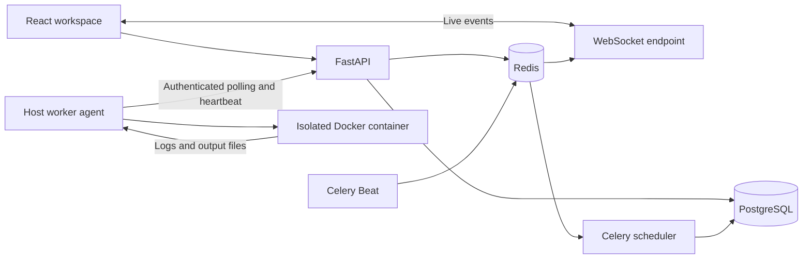

# Architecture

## Scheduling and recovery

A scheduling cycle uses a PostgreSQL transaction advisory lock to serialize lifecycle decisions, plus row locks for worker and job selection. It considers recent heartbeats, drain state, execution capability, CPU, RAM, and GPU capacity. It prioritizes higher priority numbers, then older submissions. Busy workers receive no second assignment.

Assignment produces a per-job execution lease. Only the assigned authenticated worker can claim that lease once, append logs, check cancellation, or finish the job. Worker re-registration rotates its session identifier, invalidating older worker credentials. Duplicate finishes are safe; append offsets avoid duplicating retried log batches.

The agent polls for assignments, heartbeats independently, supervises the actual container, and reports its exit code. It removes the container after execution. Queued or unclaimed assignments can cancel immediately. Running cancellation holds the worker busy until the agent confirms termination.

The scheduler handles stale heartbeats, assignments unclaimed for 60 seconds, and executions beyond their timeout plus a 120-second recovery grace period. Lost executions become failed instead of silently succeeding or being automatically duplicated. Retry is explicit and creates a new job. A worker that reports offline during execution releases its assignment through the same serialized lifecycle.

## Authentication and ownership

Passwords use salted PBKDF2-SHA256. User sessions are signed JWTs stored in HTTP-only, same-site cookies. Production cookies require HTTPS. Protected writes validate browser origins. Login attempts are rate limited through Redis. Members see their own jobs and artifacts; administrators can see all jobs, create member accounts, retrieve the registration token, and drain workers.

First administrator creation is serialized to prevent two first accounts. Outside local mode, it requires a deployment setup token. Worker registration uses a bootstrap token and returns a worker-specific credential; normal worker APIs do not accept the bootstrap token.

## API groups

All paths below are under `/api/v1`. Interactive schemas are available at `/api/v1/docs`.

| Group | Purpose |
| --- | --- |
| `GET /health`, `GET /ready` | Liveness and database/Redis readiness |
| `/auth/status`, `/auth/setup`, `/auth/login`, `/auth/me`, `/auth/logout` | Installation and session lifecycle |
| `/auth/users`, `/auth/worker-token` | Administrator account/worker management |
| `POST /jobs`, `GET /jobs`, `GET /jobs/summary` | Submit, paginate/filter, and summarize authorized jobs |
| `/jobs/{id}`, `/jobs/{id}/cancel`, `/jobs/{id}/retry` | Details and lifecycle actions |
| `/jobs/{id}/logs`, `/jobs/{id}/artifacts` | Retained output and bounded downloadable files |
| `GET /workers`, `/workers/{id}/drain` | Worker visibility and maintenance |
| `/workers/register` | Authenticated agent registration |
| `/workers/{id}/heartbeat`, `/assignment`, `/offline` | Agent liveness, polling, and shutdown |
| `/workers/{id}/jobs/{job_id}/claim`, `/control`, `/logs`, `/finish` | Leased execution protocol |
| `/ws` | Authenticated workspace invalidation events |

The UI combines live invalidation with periodic refresh. PostgreSQL remains the source of truth; event publication failures do not discard committed job outcomes.
