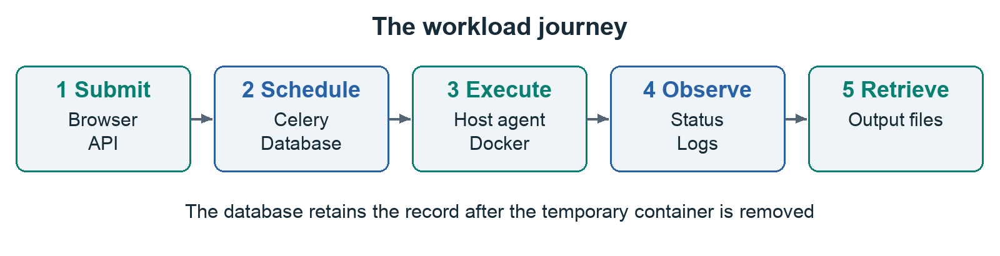
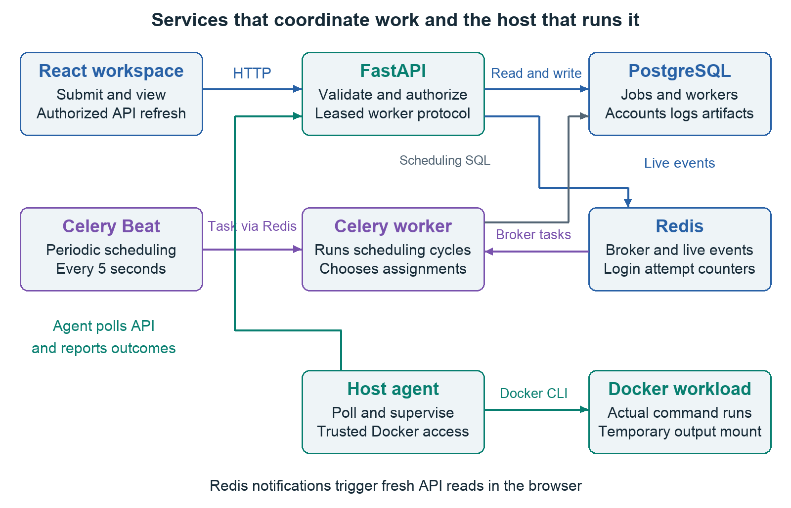
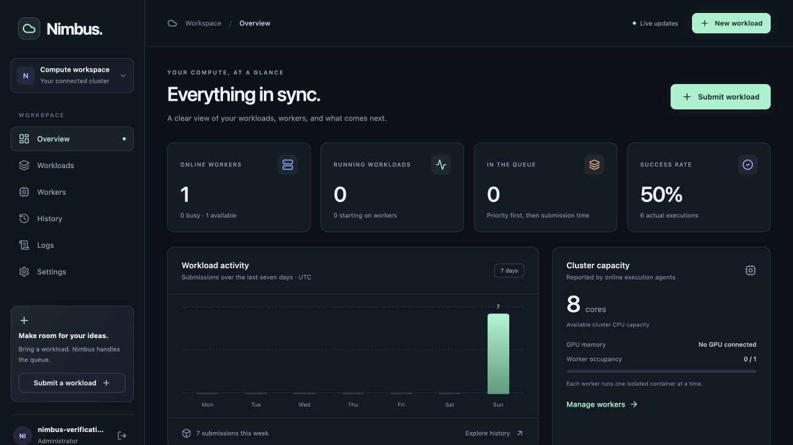
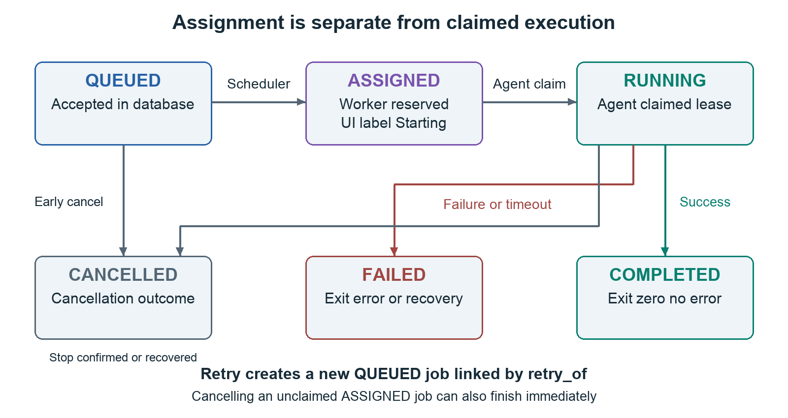
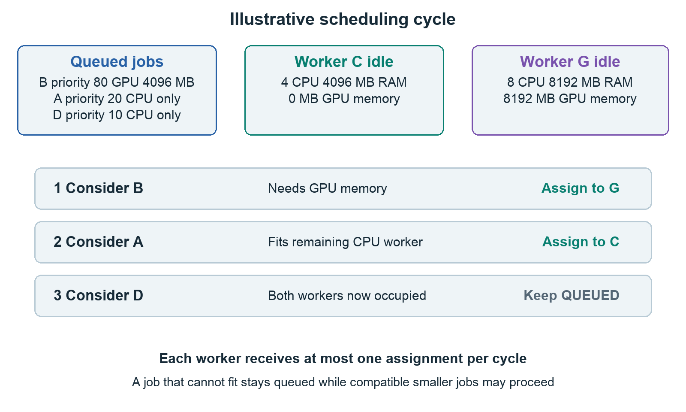
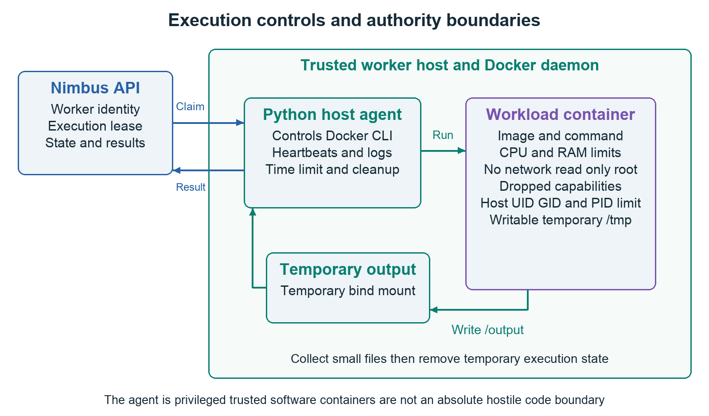
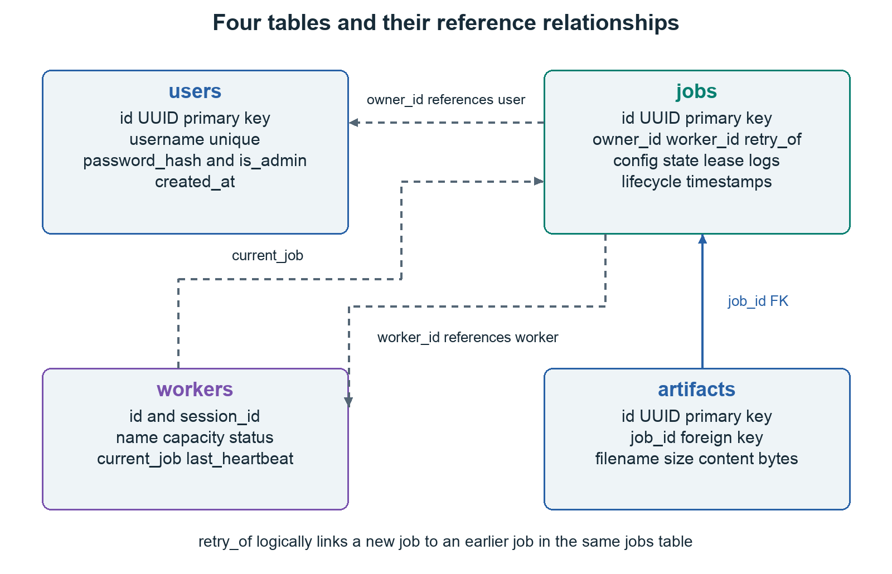
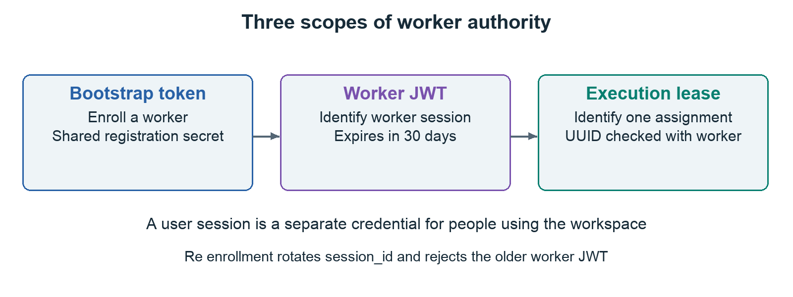
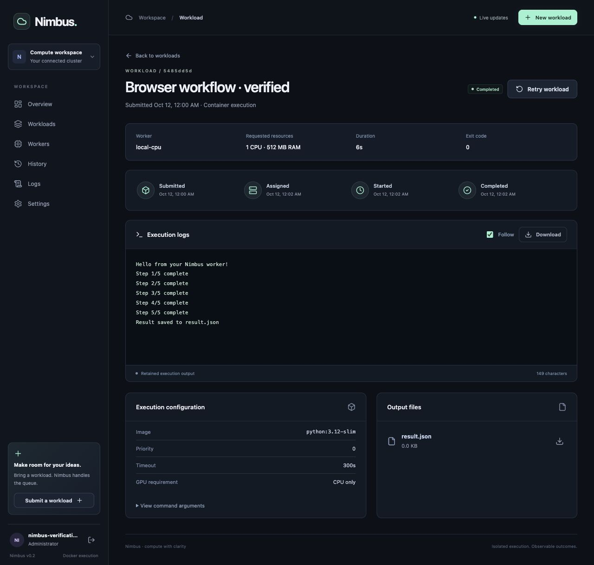

# Nimbus Project Guide

An illustrated handbook for understanding operating and presenting Nimbus

Version 0.2.0 · 12 October 2026

Nimbus is a working local and internal workload platform. A user submits a command, the scheduler chooses a compatible worker, a host agent runs the command in Docker, and the workspace shows the actual outcome, logs, and result files. Its strongest achievement is completing that entire lifecycle with explicit ownership, resource admission, cancellation, retries, and recovery.

This guide starts with familiar ideas and then follows the implementation into the frontend, API, database, scheduler, and execution agent. It also identifies the limits of this version. Use the final presentation scripts and self-test questions to explain the project accurately from memory. Example scheduling scenarios are illustrative; verification results refer to checks actually performed on the local stack.

## 01 The purpose of Nimbus

### The problem it solves

Running a small script directly in a terminal is straightforward. Managing many executions becomes harder: which command is waiting, which machine is busy, who submitted the work, whether the process really succeeded, and where its output went. When GPU machines enter the picture, a job also needs a machine with sufficient resources.

Nimbus puts those decisions and outcomes in one workspace. It separates submission from execution. You can submit work now, let it wait for suitable capacity, and return to its history later. The system records the lifecycle instead of relying on someone remembering what happened in a terminal.



Figure 1. Submit, schedule, execute, observe, and retrieve results. Each stage has a specific owner in the implementation.

### Typical uses

Suitable examples include a CPU benchmark, a small data transformation, model evaluation with dependencies already baked into an image, or a GPU experiment on an appropriately configured NVIDIA host. The supplied Hello Nimbus example is deliberately small: it prints progress and saves a JSON result. The failure example deliberately exits unsuccessfully so you can learn what a failed execution looks like.

The project name and original description refer to AI workload and GPU resource management. The current scheduler makes deterministic resource and priority decisions. It does not contain an AI model, predict execution time, or automatically optimize training. An honest description is a resource-aware container workload scheduler with a web workspace.

### What finished means for this version

Nimbus has a complete, tested local workflow and is suitable as a portfolio project or an internal MVP. A public service needs additional deployment and product work. Real NVIDIA execution, high-load behavior, backup restoration, and broad multi-host failure testing have not been validated on this machine. Understanding these limits makes a project explanation more credible.

## 02 The vocabulary you need

| Term | Meaning in Nimbus |
| --- | --- |
| Workload or job | One submitted execution request, stored as a job record with an image, command, resource requirements, and status. |
| Worker | A registered execution endpoint representing a host agent and its Docker daemon. Its name is a label. |
| Agent | The Python program on the worker machine that polls the API, heartbeats, launches Docker, and reports results. |
| Scheduler | The backend logic that chooses an eligible worker for a queued job. |
| Celery worker | A background process that runs scheduling tasks. It is distinct from the host execution agent. |
| Image | A packaged filesystem and runtime, such as python:3.12-slim, used to create a container. |
| Container | The particular running environment created from an image for one execution. |
| Artifact | A small result file collected from /output and stored for download. |
| Heartbeat | A periodic message saying that an agent is still alive. |
| Execution lease | A per-assignment UUID checked when a worker claims, logs, controls, or finishes a job. |
| Drain | Prevent a worker from receiving new assignments while allowing its active work to finish. |
| Migration | A versioned change to the database schema. |

### A familiar analogy

Imagine a workshop. The website is its reception desk. PostgreSQL is the job ledger. The scheduler decides which workbench can take each order. The host agent is the operator at a workbench, and Docker provides the controlled environment in which the work happens. Logs are the progress notes; artifacts are the finished pieces.

The analogy explains responsibilities, but the real system uses network requests, transactions, and subprocesses. Do not stretch the analogy into claims about guarantees the code does not provide.

### The legacy names you saw

Sandrone, Tsaritsa, Columbina, and the older GPU node names are records already present in the earlier database. They are labels, not a method of acquiring hardware. The upgrade preserved them and marks their executor as legacy. An offline legacy record cannot execute a new job. The scheduler selects only workers registered with the Docker executor and a recent heartbeat.

The local upgrade installed a host agent called local-cpu. Connecting another worker means running the agent on another machine and registering it with Nimbus. Merely typing a name or creating a database row does not create compute capacity. Likewise, an Apple Silicon Mac does not become an NVIDIA GPU worker because a legacy record reports GPU memory.

## 03 What we used and why

### The user interface

The frontend uses React 18.3.1 for components, TypeScript 5.9.3 for static checking, Vite 8.3.4 for development and production builds, and React Router 7.18.4 for navigation. TanStack Query 5.101.4 manages server data, caching, refresh intervals, and invalidation. Axios 1.20.0 makes HTTP requests and includes the session cookie. Lucide React supplies consistent icons. Styling is custom CSS; the earlier Tailwind configuration and unused state/chart dependencies were removed.

These are the resolved versions in package-lock.json at this revision. package.json uses compatible version ranges for several dependencies, whereas the lockfile records the exact resolved dependency tree used by npm ci. The backend requirements pin direct packages exactly, but do not provide a complete lock of all transitive Python packages.

React keeps the pages and reusable components separate. TypeScript helps catch mismatches between the expected API response and the code using it. TanStack Query is useful because job state changes outside the browser: the agent and scheduler are updating the database even when the user does nothing. The browser must retrieve fresh data rather than treating its previous response as permanent truth.

### The API and persistence layer

| Technology | Version or image | Responsibility |
| --- | --- | --- |
| Python | 3.12 in backend images | API and scheduling runtime. Host launcher requires Python 3.10 or newer. |
| FastAPI | 0.143.0 | HTTP routes, dependencies, response models, and WebSocket endpoint. |
| Uvicorn | 0.32.1 | ASGI server that runs FastAPI. |
| Pydantic | 2.14.0 | Request validation and serialization. |
| Pydantic Settings | 2.15.0 | Load typed configuration from environment variables. |
| SQLAlchemy | 2.0.36 | Async database queries, models, and transactions. |
| asyncpg | 0.30.0 | Async PostgreSQL driver used by the application. |
| psycopg2 binary | 2.9.10 | Synchronous PostgreSQL driver, including test database management. |
| PostgreSQL | 16 alpine | Durable job, worker, account, log, and artifact data. |
| Alembic | 1.14.0 | Version and apply database migrations. |
| Redis | 7 alpine server and 5.2.1 Python client | Celery messaging, live event pub/sub, and login attempt counters. |
| Celery | 5.4.0 | Execute periodic scheduling tasks in background processes. |
| Flower | 2.0.1 | Inspect Celery activity during administration. |
| PyJWT | 2.15.1 | Sign and verify user and worker credentials. |
| structlog | 24.4.0 | Structured backend logs. |
| Docker and Compose | Host installation | Run the application services and isolated workload containers. |
| nginx | 1.27 alpine image | Serve the production frontend and proxy API and WebSocket traffic. |

### The division between PostgreSQL and Redis

PostgreSQL holds the durable truth: ownership, assignment, status, logs, and results. Redis carries background task messages and short-lived live notifications. The queue shown on the Workloads page is based on PostgreSQL jobs with QUEUED status. It is not a list of workload commands directly consumed from Redis by execution agents.

Redis may tell the browser that something changed. The browser then asks the API for the current authorized data. If an event is missed, periodic refresh can recover the display. Redis is important to scheduling and live updates, but a transient event publication failure does not erase a database commit.

### The development and verification tools

pytest and pytest-asyncio exercise backend behavior against PostgreSQL. Vitest and Testing Library exercise frontend workflows. Ruff checks and formats Python, mypy checks backend types, ESLint checks frontend code, TypeScript checks compilation, and Prettier formats the frontend. pip-audit and npm audit check published dependency advisories. GitHub Actions contains the repeatable CI configuration. Passing these checks is evidence of specific behavior; it is not proof of perfect security or arbitrary scale.

## 04 The architecture and the two kinds of worker



Figure 2. The application services schedule and store work. A separately running host agent controls the workload containers through the host Docker CLI.

### Inside the Compose stack

The frontend serves the workspace. FastAPI handles authentication, validation, ownership checks, job actions, worker requests, and downloads. PostgreSQL persists the records. Redis is the broker and event channel. Celery Beat creates a scheduling task every five seconds by default, and a Celery worker executes the scheduling cycle. Flower and pgAdmin are administrative conveniences, not prerequisites for understanding a job's execution.

The scheduler's Celery task calls asyncio.run around an async scheduling function. The application uses SQLAlchemy NullPool so connections are not reused across independent event loops in repeated Celery cycles. This avoids keeping a pooled connection attached to an event loop that has already closed. NullPool favors straightforward lifecycle correctness here; connection pooling should be revisited carefully for a higher-throughput deployment.

### Outside the stack

backend/scripts/worker_agent.py runs on the host, where the Docker CLI is available. It uses Python's standard library, including urllib for HTTP, subprocess for Docker, threading for heartbeats and reading output, queue for buffering, and tempfile for the output directory.

It registers, receives a worker-specific token, polls for assignments, claims an execution lease, launches a container, and reports progress and the outcome. There is no Docker socket mounted into FastAPI. Moving execution control into the host agent reduces the authority held by the API container, although the agent itself remains trusted software with powerful Docker access.

### The distinction to remember

The Celery worker schedules. The host worker agent executes. Both names contain worker, but they do different jobs. Redis carries Celery scheduling messages; the host agent discovers its assigned workload by polling the FastAPI assignment endpoint. If only the Celery services are running, jobs can exist in the queue without any machine capable of executing them.

## 05 Navigating the workspace



Figure 3. The overview screenshot was captured during verification. Its successful and unsuccessful executions include intentional failure, timeout, and cancellation tests.

### The pages

| Page | Purpose | What to inspect |
| --- | --- | --- |
| Overview | A summary of cluster and authorized workload activity. | Online workers, running/queued counts, recent jobs, success rate, and the seven-day chart. |
| Workloads | All authorized jobs, including waiting and finished work. | Search by title, filter status, paginate twenty at a time, and open a detail page. |
| Workers | Registered machines and older records. | Docker versus legacy executor, status, capacity, heartbeat, assignment, and drain controls. |
| History | Terminal executions. | Completed, failed, and cancelled outcomes; retry an executable job from its details. |
| Logs | Output from recent jobs. | Select a workload, follow output, and download retained logs. |
| Settings | Account information and worker enrollment. | Add a member account as administrator; obtain remote-agent instructions and the registration token. |

### Your first run

Start with New workload, select Hello Nimbus, and keep the default Python image, one CPU, 512 MB RAM, zero GPU memory, and 300-second timeout. Submit it. Open the detail page and watch its timeline and output. After completion, download result.json. This validates the full user journey without needing a GPU or a custom image.

For the current installation, the administrator account is chosen by the user. The temporary account used during verification was removed. Once someone has completed setup, later visits show sign-in rather than another first-administrator form.

### How to interpret the overview

The success rate is completed real executions divided by all terminal jobs with an execution token. That denominator includes failed executions and cancelled jobs that reached assignment. Legacy jobs and jobs cancelled before any assignment are excluded. With three completions, two failures, and one assigned cancellation, the rate is 50 percent. That can reflect intentional tests rather than a malfunctioning platform.

The seven-day chart groups submissions by UTC day. Individual timestamps are displayed in the browser's local time. The cluster CPU number is the sum of the advertised CPU capacities of online Docker workers, including busy workers. It is not a measurement of free CPU utilization or capacity remaining inside partially used workers. The current UI label says available capacity, but the actual calculation represents total online advertised capacity.

## 06 Following one job through the complete system

### The request

In script mode, the frontend converts your Python text into the argument array ["python", "-u", "-c", script]. The -u option asks Python for unbuffered output so progress messages are easier to observe promptly. In advanced mode, you supply a JSON array of strings. The agent passes that array directly to Docker's subprocess argument list; it does not build a shell command by concatenating the strings.

This is an illustrative request body matching the API's shape:

```json
{
  "title": "My first result",
  "image": "python:3.12-slim",
  "command": ["python", "-u", "-c", "print('Hello Nimbus')"],
  "cpu_request": "1",
  "memory_limit_mb": 512,
  "gpu_memory_request": 0,
  "timeout_seconds": 300,
  "priority": 0,
  "estimated_runtime": 0
}
```

### The steps and their owners

1. The browser sends POST /api/v1/jobs using Axios with the session cookie. It performs useful form checks, including rejecting malformed advanced command arrays before calling the API.
2. FastAPI authenticates the user. Pydantic validates the request again. Browser validation improves usability; backend validation is the authoritative gate.
3. job_service.create_job creates a UUID and stores the job with the user's owner_id and QUEUED status. The API returns HTTP 201 and the job response.
4. The frontend invalidates cached job and summary data, then navigates to /jobs/{id}. The page can explain why the job is waiting.
5. A Celery scheduling cycle selects an eligible worker and records ASSIGNED, worker_id, assigned_at, a fresh execution_token, and the worker's BUSY/current_job fields in one transaction.
6. The agent's next assignment poll obtains the job and lease. The agent sends a claim request. A successful claim changes the job to RUNNING and records started_at. A repeated claim is rejected.
7. The agent creates a temporary output directory and starts docker run with the requested image and command plus execution restrictions. The image may need downloading before the actual program starts.
8. A reader thread captures stdout and stderr. The agent sends log batches, keeps heartbeating, checks cancellation, and enforces the timeout.
9. After the process exits, the agent collects allowed files, removes the container, and sends the finish request with lease, exit code, reason, and base64-encoded artifacts.
10. The API stores the actual outcome and files, records completed_at, clears the worker assignment, and publishes an invalidation event. The browser retrieves the updated job and output.

### Why a submission can succeed before execution starts

HTTP 201 means the job was accepted and stored. It does not mean its Docker command succeeded. A worker may be offline, busy, unable to meet the request, or unable to download the image. Acceptance and execution are separate stages, each with its own evidence in the timeline.

The system does not keep the submission request open until a long-running workload finishes. That allows the user to navigate away while the worker continues, and lets many submitted jobs wait for capacity.

## 07 States cancellation and retries



Figure 4. Completed, failed, and cancelled are terminal states. Early cancellation can bypass running; retry creates a different job rather than rewinding the original.

| Stored state | UI label | Meaning |
| --- | --- | --- |
| QUEUED | Queued | The request exists but has no active assignment. |
| ASSIGNED | Starting | A worker has been reserved and a lease issued; the agent has not claimed it yet. |
| RUNNING | Running | The agent has claimed the job and is supervising execution, including any startup/image download. |
| COMPLETED | Completed | The agent reported exit code zero with no execution failure reason. |
| FAILED | Failed | Nonzero exit, an execution error, timeout, or recovery failure. |
| CANCELLED | Cancelled | Cancellation reached a terminal outcome, including the recovery path for lost cancelled work. |

### Cancellation before and during execution

A queued job can cancel immediately. An assigned job can also cancel before claim; the API releases the worker reservation and a later claim is rejected. A running job is different: the API sets cancel_requested but keeps RUNNING and the worker busy. The agent checks control approximately every two seconds, terminates the container, and reports finish. The finish handler then gives CANCELLED precedence when cancellation was requested.

This is why the UI says cancellation requested before it says cancelled. Releasing the worker immediately could allow another assignment while the original container still runs. The pending state communicates the physical stop has not yet been confirmed. On a heartbeat-expiry recovery path, cancellation can become terminal without direct confirmation from the disconnected machine; inspect that machine before trusting its physical cleanup.

### Retry preserves history

Only terminal jobs with executable commands can retry. The API copies the configuration into a new job with a new UUID, QUEUED status, and retry_of pointing to the previous job. The user requesting the retry owns the new job. The earlier record keeps its timestamps, logs, exit code, and results. Legacy records with no command cannot retry because Nimbus has no executable definition to reproduce.

Retries are explicit rather than automatic. After losing contact with a machine, Nimbus cannot know immediately whether its command is still doing work. Automatically duplicating that command could repeat an external action in a more permissive future configuration. Even in the current no-network environment, an explicit retry keeps uncertainty visible.

## 08 The scheduling algorithm in detail

### Admission and ordering

An eligible worker must be IDLE, have no current_job, advertise executor docker, have a recent heartbeat, and not be draining. The scheduler compares the job's CPU, RAM, and GPU-memory request against that worker's advertised capacity. All three must fit. A CPU job requests zero GPU memory; a GPU job cannot fit a CPU-only worker.

Jobs are sorted by priority descending and creation time ascending. Workers are sorted by GPU memory and then CPU capacity ascending. For each job, the scheduler takes the first compatible worker in that ordering. This tends to leave larger GPU machines available when a smaller worker can handle a CPU job. It is a greedy heuristic, not an optimal bin-packing solver.

After an assignment, the worker is removed from the candidates for the current cycle. Each agent runs one job at a time, even if the job requests one CPU from an eight-core worker. There is no packing of several simultaneous jobs into the remaining capacity. RAM is checked for fit but is not part of the candidate sort order. estimated_runtime is stored for compatibility with the schema; it does not influence scheduling.



Figure 5. Illustrative example: a high-priority GPU job uses the GPU worker, a CPU job uses the CPU worker, and another job waits because both agents are occupied.

### Worked example

Suppose worker C offers four CPUs, 4096 MB RAM, and zero GPU memory. Worker G offers eight CPUs, 8192 MB RAM, and 8192 MB GPU memory. Both are idle and recent. Job B requests two CPUs, 2048 MB RAM, 4096 MB GPU, and priority 80. Job A requests two CPUs, 512 MB RAM, zero GPU, and priority 20. Job D requests one CPU, 512 MB RAM, zero GPU, and priority 10.

B is considered first. C cannot fit its GPU requirement, so G receives B. A is next and fits C. D waits because no idle candidate remains. When a worker finishes, a later scheduling cycle can assign D. If B requested 16384 MB GPU, neither worker could admit it; B would stay queued while compatible lower-priority CPU work could still proceed. A blocked large job does not stop the entire queue.

### Preventing conflicting decisions

The code takes a PostgreSQL transaction advisory lock with key 6472026 for lifecycle mutations. Scheduling, claiming, cancellation, draining, logging, and finishing use the coordinated transition path where appropriate. The scheduler also selects rows with FOR UPDATE SKIP LOCKED. These protections help prevent two scheduling processes assigning the same job or worker inconsistently.

The advisory lock serializes these mutations across processes. That is a deliberate simplicity tradeoff: it makes races easier to reason about but can become a throughput bottleneck. Row locks complement it; they do not make this version a highly parallel scheduler on their own. A successful transaction changes both the job and worker reservation before other lifecycle decisions proceed.

### Waiting reasons

The detail page distinguishes no online execution worker, insufficient compatible CPU/RAM/GPU capacity, compatible workers busy, and readiness for the next cycle. Legacy jobs without an executable command get a separate explanation. Worker health is based on recent heartbeats, not a guarantee that the host has no unrelated resource usage. Run one agent per Docker daemon so the same hardware is not advertised twice.

## 09 How the host agent executes safely

### Enrollment and capacity discovery

The agent uses docker info to obtain the Docker daemon's CPU count and memory, reserving 256 MB from its advertised memory total with a 64 MB minimum. On Docker Desktop these are the VM resources exposed by Docker, which may differ from your Mac's full physical resources. It attempts nvidia-smi to discover GPU memory and utilization, advertising the largest detected GPU rather than pretending several GPUs form a pooled memory device.

Registration sends its name, CPU capacity, RAM capacity, GPU memory, utilization, and executor type. The server returns a worker-specific credential lasting thirty days. The agent replaces its bootstrap credential with that credential for subsequent calls. Re-registering an offline worker name rotates session_id and makes the older credential invalid.

### The loop

The agent polls assignments approximately every two seconds and sends heartbeats from a separate thread every five seconds. A long execution does not intentionally suppress heartbeats. The output reader thread places decoded stdout/stderr chunks into a bounded queue, while the main execution loop handles control checks, log uploads, timeout checks, and process completion.

Transient server errors and rate limiting can be retried with bounded exponential backoff. Other client errors are rejected promptly. These retries are why log offsets and idempotent finish handling matter. The agent is not a permanently self-healing daemon: if it stops because its credential expires or registration fails, an operator must restart or supervise it.



Figure 6. The agent is trusted to control Docker. The workload receives a temporary output mount and restricted execution settings; it does not receive the repository or the API's Docker socket.

### Container controls

| Docker control | Effect and practical implication |
| --- | --- |
| --cpus | Limits CPU time to the requested allocation; fractional values are supported. |
| --memory and equal --memory-swap | Sets the RAM limit without allowing additional swap beyond that limit. |
| --pids-limit 128 | Restricts the number of processes in the container. |
| --network none | Disables workload network access; it cannot download packages or datasets at runtime. |
| --read-only | Keeps the image filesystem read-only. |
| --cap-drop ALL | Removes Linux capabilities from the workload. |
| no-new-privileges | Prevents gaining additional privileges through execution. |
| Host UID and GID | Runs with the agent's numeric user identity; use an ordinary host user. |
| Temporary /tmp | A writable 64 MB tmpfs with noexec and nosuid. |
| Temporary /output | The only extra host bind mount, used to collect results. |

For GPU jobs the agent adds --gpus all. GPU memory is an admission requirement, not an enforced VRAM limit. The implementation does not allocate a particular GPU ID or split multiple GPUs between simultaneous jobs. Dependencies, executable files, and appropriate working paths must already be present in the image. The default working directory is /output, so a relative script.py must exist there or you should use an absolute script path included in your custom image.

### Timeout and cleanup limits

The execution timer begins after claim and before docker run, so image download and startup consume the timeout. The loop attempts docker kill when the timeout or cancellation is detected, and docker rm -f in a finally block. It also terminates or kills a remaining Docker CLI subprocess. An agent shutdown attempts to stop its current container and report offline.

Docker control can still fail, and an agent or host can crash before cleanup. Restrictions reduce workload authority but do not make containers an absolute hostile-code security boundary: they share a kernel or Docker VM, and the agent controls a powerful daemon. Use trusted hosts and images. Reported resource capacity is admission information, not exclusive ownership of the whole physical machine.

## 10 The database and migrations



Figure 7. Dotted arrows represent UUID references enforced primarily by application logic. Artifact.job_id has an actual database foreign key to jobs.id.

### Four main tables

users contains a UUID, unique username, password hash, administrator flag, and creation time. jobs contains submission configuration, owner_id, worker_id, state, execution lease, log text, result metadata, retry_of, and lifecycle timestamps. workers contains the named endpoint, session identifier, capacities, executor type, drain state, status, current_job, heartbeat, and creation time. artifacts contains job_id, filename, byte size, and file content stored as binary data.

Several relationship-looking fields are plain UUID columns, not declared foreign keys: job ownership, assigned worker, retry_of, and the worker's current_job. The services coordinate them, and tests check important invariants, but the database does not enforce every logical relationship. Artifact.job_id is the declared foreign key. This distinction is important when describing integrity and planning a future schema hardening step.

### Important invariants

A worker represents at most one current assignment. Assignment updates both sides together. Only the assigned worker and correct execution lease can mutate the execution protocol. Terminal jobs are retained rather than overwritten by a retry. A member cannot retrieve another user's job merely by knowing its UUID. The API omits execution_token from ordinary JobResponse objects; it is provided through the authenticated assignment protocol instead.

### Why timestamps and types matter

created_at, assigned_at, started_at, and completed_at answer different questions. Waiting time and execution duration are not the same quantity. CPU values use a numeric/Decimal representation so fractional requests are retained without depending on binary floating-point rounding. Commands use JSON arrays, not an opaque shell string. Status enums restrict the vocabulary of states.

The services use naive datetime values representing UTC. The frontend normalizes timestamps lacking timezone information to UTC before displaying them locally. This convention works when consistently followed; explicit timezone-aware storage would be a sensible later improvement.

### Migration history

The migration chain begins with the original jobs table, adds the missing workers base revision, applies the older heartbeat revision, adds real execution/account/artifact fields, and finally adds worker sessions. The missing base migration checks whether workers already exists so an existing local database can be upgraded while a new database can be created from nothing.

The execution migration preserves earlier completed records, marks older workers offline/legacy, and fails interrupted legacy running jobs rather than pretending they completed. Database startup runs alembic upgrade head before the API server. Tests create fresh databases and apply the chain, which checks that the project does not depend on undocumented manually created tables.

## 11 Authentication ownership and worker credentials

### User access

First-time setup creates an administrator. A separate PostgreSQL advisory lock serializes that setup so two simultaneous setup requests cannot both become the first user. In local mode setup is available without a deployment secret. Outside local mode, SETUP_TOKEN must match the X-Nimbus-Setup-Token header before the initial administrator can be created.

Passwords are hashed using salted PBKDF2-HMAC-SHA256 with 600000 iterations. Verification uses a constant-time comparison. The database stores a hash representation, not the submitted plaintext password. Password hashing runs through asyncio.to_thread so the CPU-heavy work does not intentionally block the API event loop.

User JWTs contain subject, kind=user, and expiry. Verification accepts the configured HS256 signing algorithm explicitly and requires those claims. The browser stores its session in the nimbus_session HTTP-only cookie with SameSite=Lax. Production mode sets the Secure cookie flag, requiring HTTPS. HTTP-only prevents JavaScript from directly reading the cookie; it does not solve every cross-site scripting risk.

### Authorization

Members can access and act on their own workloads. Administrators can manage all jobs, create member accounts, drain workers, and retrieve the registration credential. Protected cookie-authenticated writes check a supplied Origin against allowed frontend origins. The implementation uses this origin check together with SameSite cookies; it does not implement a separate synchronizer CSRF token mechanism.

Sign-in attempts are counted in Redis with a one-minute window and a ten-attempt threshold per client address. Reverse-proxy deployments must consider which address the application sees before treating this as precise per-person throttling. The current account UI does not provide password reset, account deletion, or member self-service password changes.



Figure 8. The registration secret enrolls an agent, the worker credential identifies that agent session, and the execution lease identifies one assignment.

### Three separate credentials

The bootstrap registration token is explicitly configured with WORKER_API_TOKEN or derived from SECRET_KEY using HMAC and a fixed registration context. Any holder can enroll a worker, so it is privileged information. The administrator reveal endpoint returns it with Cache-Control no-store. Revealing it in Settings does not rotate it; the refresh button fetches the same configured credential again.

The worker JWT identifies a worker UUID and its session_id. Its thirty-day expiration differs from the default one-day user session. worker_auth checks the stored session identifier, so reconnecting an offline worker invalidates its older JWT. Finally, the execution_token is a job-specific UUID. Worker requests must satisfy both worker identity and the assignment lease. A copied user session cannot substitute for a worker credential.

### Remaining security scope

Secrets must stay out of Git, screenshots, chat, and command output. The local Compose ports bind to 127.0.0.1. Remote agents need a reachable deployment API and HTTPS; the bundled local configuration does not expose one publicly. Shared WebSocket invalidations include event identifiers across connected users, while API retrieval enforces ownership; per-user event filtering and checking live account validity throughout socket sessions are future hardening opportunities. Signed user tokens are not maintained in a revocation list, so deleting a browser cookie is not revoking every copied token.

## 12 Live updates logs and output files

### How the browser stays current

After a job or worker change, the backend can publish a JSON event on the Redis nimbus:events channel. Each API process runs a Redis bridge, which broadcasts to its connected authenticated WebSocket clients. The browser's useLiveUpdates hook invalidates related TanStack Query entries and retrieves fresh API data. Notifications are small signals; they are not the job database or the full stdout stream.

The WebSocket address is /api/v1/ws. The development Vite proxy and production nginx proxy support it. Relative API and WebSocket configuration keeps requests on the same origin. The hook attempts reconnection after three seconds. Overview queries refresh every ten seconds; workload lists every five; job details every two; active log views every two; artifact lists every five. Updates can therefore arrive promptly through events while polling provides a fallback.

### How logs are retained

The agent combines stdout and stderr, decodes invalid UTF-8 safely, batches text, and uploads batches no larger than 16384 characters. Each upload includes an offset. If the offset equals the retained length, the server appends within the cap. An earlier offset is treated as already received and returns the current offset; an offset ahead of the server is rejected. This prevents a retried accepted batch from being blindly duplicated.

The retained limit is 1000000 characters. It is a character cap, not a strict one-megabyte byte cap for multibyte text, even though part of the UI describes it as a 1 MB retention limit. The API supports an offset for reads, but the current LogViewer retrieves the retained text as a whole on refresh. That is simple for a bounded local workload; large-scale log streaming would need a more efficient design.

### How artifacts are collected

The agent inspects regular files directly under its temporary /output directory after execution. It excludes symlinks and files whose names do not match the safe filename pattern. It collects at most eight files, each no larger than 2 MiB, with at most 8 MiB total. Nested directories and oversized files are skipped. The temporary directory is removed after collection/reporting, so skipped outputs are not durable results.

The finish request sends base64-encoded file bytes. The API validates individual bounds and the combined bound, saves the bytes in PostgreSQL, and serves them as authenticated attachment downloads. Files produced by failed or cancelled executions can also be collected. An empty artifact list does not mean the program failed: a program may only print output or write files somewhere outside the collected directory.



Figure 9. A real browser submission completed on local-cpu. The page separates status, resources, timing, logs, command configuration, and output files.

## 13 Failure handling and recovery

### Ordinary program failure

A command that exits with a nonzero code becomes FAILED. If it did not supply another execution reason, the API records a container exit-code message. A traceback in stderr is preserved in the combined log stream. A program can also fail before it starts: an unavailable image, incompatible architecture, missing executable, or an attempt to write to a read-only location can produce a Docker execution error.

### Timeout and loss of contact

The agent enforces the requested timeout and attempts container termination. Independently, the scheduler detects stale workers after the default 45-second heartbeat threshold. It marks the worker offline, clears its current assignment, and fails unfinished work, or cancels it if cancellation was already requested. An assignment not claimed for sixty seconds fails. A running job beyond its timeout plus a 120-second grace period also fails through recovery logic.

These checks run on scheduling cycles rather than as a perfect instant timer. They record that Nimbus has lost confidence in the execution, not that a disconnected host has certainly stopped. A recovering agent checks control and can attempt to stop, but a network partition or host crash prevents immediate observation. Inspect the worker before manually retrying uncertain work.

### Idempotency and its limits

The finish endpoint returns the existing terminal record when the same valid lease reports finish again. It does not add duplicate artifacts on that repeated finish. Claims are accepted once, and log offsets suppress simple duplicate uploads. These protections support retryable HTTP delivery.

They do not constitute a universal exactly-once execution guarantee. A worker may start a command and lose connectivity before reporting it. The system has no transactional link between an arbitrary external side effect and a PostgreSQL status update. The current container network restriction reduces some side effects, but the correct claim remains controlled assignment and duplicate-resistant reporting, not globally exactly-once computation.

## 14 Read the source with a purpose

### The backend route to follow

Begin with app/main.py to see application creation, CORS, and the lifespan event bridge. Then follow api/v1/router.py to its endpoint groups. Read schemas/job.py for accepted request shape, models/job.py for stored state, api/v1/endpoints/jobs.py for user-facing actions, and services/job_service.py for transitions and artifact retention.

Next read services/scheduler_service.py. Identify the transition lock, stale-worker recovery, eligibility filters, ordering, fit comparison, and paired updates. Then read api/v1/endpoints/workers.py to see how an agent obtains an assignment, claims it, appends logs, checks control, and finishes. Finally read scripts/worker_agent.py from registration through the execute function. This follows the same causal order as a job rather than reading random files alphabetically.

### The frontend route to follow

Start with App.tsx and useSession.tsx to understand protected routing and first setup. Follow NewJobPage.tsx to the command transformation and POST. Read QueuePage.tsx for server filtering and pagination, JobDetailPage.tsx for lifecycle actions and timeline, LogViewer.tsx for output refresh, and useClusterData.ts for live invalidation and summary polling. api/client.ts centralizes cookies, timeouts, error text, and downloads.

### A source map

| Responsibility | Repository path |
| --- | --- |
| Configuration and environment parsing | backend/app/core/config.py |
| Passwords and JWTs | backend/app/core/security.py |
| User, administrator, and worker checks | backend/app/core/auth.py |
| Job state and results | backend/app/services/job_service.py |
| Worker liveness and enrollment | backend/app/services/worker_service.py |
| Scheduling policy and recovery | backend/app/services/scheduler_service.py |
| Scheduler task and periodic configuration | backend/app/workers/tasks/scheduling.py and celery_app.py |
| Actual container execution | backend/scripts/worker_agent.py |
| Local startup and shutdown | scripts/local.py and scripts/start_worker.py |
| Server data and live updates | frontend/src/hooks/useClusterData.ts |
| Submission and job inspection | frontend/src/pages/NewJobPage.tsx and JobDetailPage.tsx |
| Integration and workflow tests | backend/app/tests and frontend/src/tests |
| Repeatable CI checks | .github/workflows/ci.yml |

The earlier Celery execution module now contains only a statement that execution belongs to host agents. It is not a hidden second execution engine. The unused old frontend authentication store was removed; session behavior lives in the provider and query cache.

## 15 Run configure and maintain Nimbus

### First startup on a new checkout

Install and start Docker Desktop or Docker Engine with Compose. Install Python 3.10 or newer for the host launcher and have Make available. The backend Python and frontend Node runtimes are supplied by containers, so a separate local Python environment or npm install is not necessary for the standard quick start.

```sh
cp .env.example .env
openssl rand -hex 32
```

Copy the generated secret into SECRET_KEY in .env. Do not reuse the example placeholder. Then run:

```sh
make dev
```

The launcher starts Compose with development images, applies migrations before API startup, waits for readiness, and starts the host agent. It records the agent PID and logs under the ignored .nimbus directory. Open http://localhost:5173, choose the administrator credentials if setup is required, and run Hello Nimbus.

### Everyday commands

| Command | What it does |
| --- | --- |
| make dev | Build/start the stack and ensure the host agent runs. |
| make agent | Start the local agent against an already running stack. |
| make stop-agent | Gracefully stop the recorded host agent and its active execution. |
| make down | Stop the agent and services while retaining named data volumes. |
| make ps | Show the current Compose services. |
| make logs | Follow service logs. |
| make migrate | Apply outstanding database migrations. |
| make up | Start development Compose in the foreground; start an agent separately. |
| make up-prod | Run the production-image Compose path; start an agent separately. |

The local manager checks that a recorded PID belongs to this repository's start_worker.py command before signalling it. It avoids blindly killing an unrelated process that reused the old PID. Runtime .nimbus files and .env must remain untracked. Removing containers is different from deleting persistent database volumes; keep volumes when you want history to survive.

### Configuration you should understand

SECRET_KEY signs JWTs and supplies the derived worker bootstrap token when an explicit WORKER_API_TOKEN is absent. SETUP_TOKEN protects initial setup outside local mode. BACKEND_CORS_ORIGINS lists exact browser origins, such as http://localhost:5173 or an HTTPS deployment domain. ACCESS_TOKEN_EXPIRE_MINUTES defaults to 1440. Worker heartbeat expiry defaults to forty-five seconds, and scheduling polls default to five seconds.

The bundled agent itself heartbeats every five seconds. WORKER_HEARTBEAT_INTERVAL_SECONDS exists in configuration but does not currently drive that hard-coded agent loop. Similarly, database pool-size environment values do not control a pool while NullPool is active. Explain the settings that actually affect behavior instead of assuming every named field is wired into the implementation.

### Adding another execution machine

Obtain the registration token as an administrator in Settings, save it in a private token file on the intended host, and run the copied worker_agent.py:

```sh
python3 worker_agent.py --name compute-01 \
  --api-url https://your-nimbus-host/api/v1 \
  --token-file /path/to/private-worker-token
```

Use a unique name and one agent per Docker daemon. The remote machine needs network access to the API and a working Docker CLI. GPU execution additionally needs supported NVIDIA hardware, nvidia-smi, and NVIDIA container support. The standard local 127.0.0.1 bindings are not a remote enrollment endpoint; deploy a reachable API before attempting this.

To maintain a worker, pause new assignments on the Workers page, let current work finish, then stop the agent. Resume assignments after it is ready again. Restart before the thirty-day worker credential expires, or supervise the agent as an operational service in a remote installation.

## 16 A worked Python example

Paste this script into New workload with the default Python image:

```python
import json
import time
from pathlib import Path

print("Starting a small calculation", flush=True)
total = 0
for number in range(1, 6):
    total += number * number
    print(f"Processed {number}; total is {total}", flush=True)
    time.sleep(1)

result = {"sum_of_squares": total, "items": 5}
Path("/output/result.json").write_text(json.dumps(result, indent=2))
print("Saved result.json", flush=True)
```

json creates a portable structured result, time makes progress visible, and pathlib writes to the collection directory. The loop calculates 1 + 4 + 9 + 16 + 25, so the expected sum_of_squares is 55. flush=True makes each progress message available without waiting for a larger buffer. The program exits normally, so the reported exit code should be zero. Download the file and compare the result with that expectation.

### Three small learning experiments

First replace the final print with raise RuntimeError("Learning how failures appear"). Predict that the job will fail, then check the traceback, exit code, and whether the earlier result file was still collected. Second set a two-second timeout while keeping the five one-second delays. Predict an incomplete log and a timeout failure. Third return to a 300-second timeout, submit, and cancel while running. Observe cancellation requested before its terminal outcome.

These exercises distinguish program failure, control-plane timeout, and user cancellation. Do them with disposable example workloads and inspect the history afterward. Repeating a job via Retry should produce a new UUID and a Retry of link rather than changing the old evidence.

### When a custom image is necessary

The default slim Python image does not promise packages such as NumPy, PyTorch, or a specific model. Bake dependencies into a compatible custom image and use an absolute executable/script path where needed. Because the container has no network and no repository mount, pip install inside your submitted script or a relative path to a file on your Mac will not work as a way to supply missing dependencies.

## 17 Testing and evidence

### What the automated checks cover

At verification, fifteen backend tests passed: health; authentication and initial setup; full leased lifecycle with logs/artifacts; concurrent scheduling; resource admission; running cancellation; queued cancellation and retry; stale-worker recovery; claim-once behavior; member ownership; validation and browser origin protection; drain/duplicate enrollment; timeout recovery; literal search/history; and replacement of old worker credentials.

Three frontend tests passed: submitting an executable template and navigating to its detail page, rejecting malformed advanced command data before an API call, and keeping a running cancellation pending until worker confirmation. Backend Ruff and strict mypy passed. Frontend ESLint, TypeScript, and the production build passed. The npm dependency audit and runtime Python dependency audit reported no known vulnerabilities at the time of checking.

### Tests do not erase your jobs

Backend fixtures create a uniquely named nimbus_test database, run Alembic migrations against it, and override the application's session dependency. Each test resets that disposable database, and the database is dropped after the suite. They do not truncate the workspace's production/local tables. PostgreSQL-specific locks and enum behavior are tested on PostgreSQL rather than approximated with SQLite.

These integration tests simulate the authenticated worker protocol to exercise backend invariants. They do not launch a real Docker container for every assertion. Separate end-to-end checks launched actual containers through the host agent, validating the execution boundary beyond the HTTP simulation.

### Actual execution checks

| Scenario | Observed outcome |
| --- | --- |
| Successful Python command | Exit zero, retained stdout, collected result.json, downloaded and parsed. |
| Intentional exit code seven | FAILED with the actual nonzero exit code. |
| Two-second execution timeout | Container terminated and failure reason recorded. |
| Cancellation while running | Stop confirmed by the agent before normal terminal cancellation reporting. |
| Retry | A separate linked execution ran and completed. |
| GPU requirement on CPU-only host | Stayed queued with a compatibility explanation; no false GPU assignment. |
| Submission through the browser | Real Hello Nimbus execution completed with visible logs and a downloadable file. |
| Production image and proxy | Both images built; nginx SPA, authenticated API, readiness, headers, and WebSocket checks passed. |

Test containers were removed. The original six legacy jobs and older worker records were preserved. Verification jobs remain with descriptive titles, so intentional failures and cancellations are visible in the history. Mobile checks used a 375-pixel viewport and identified a table-overflow issue that was fixed.

### Run the repeatable checks

```sh
make test-backend
make lint-backend
docker compose exec backend mypy app --exclude tests
make test-frontend
make lint-frontend
docker compose exec frontend npm run build
```

GitHub Actions defines separate backend and frontend jobs. The backend job starts PostgreSQL and Redis services, installs development requirements, then runs Ruff, mypy, and pytest. The frontend job uses Node 22, npm ci, tests, lint, and the build. Local validation and a hosted Actions run are separate evidence; inspect the repository's Actions page for the hosted result after pushing.

## 18 Troubleshooting from symptoms

| Symptom | Likely causes | First useful check |
| --- | --- | --- |
| Workspace cannot reach API | Services stopped, startup migration failed, or wrong API routing. | Compose service status and backend logs; /api/v1/ready. |
| Job stays queued | No agent, drain state, busy compatible workers, or oversized/GPU request. | The job's waiting reason and the Workers page. |
| Only legacy workers appear | Older database records exist but no current Docker agent is enrolled. | make agent and .nimbus/worker.log. |
| Job fails immediately | Image download error, wrong architecture, missing executable, or filesystem assumptions. | Failure reason and retained logs. |
| No output files | Files written elsewhere, nested paths, unsafe names, oversized output, or no files produced. | Write a small direct /output/result.json file. |
| Progress appears late | Program buffering or slow startup/image download. | Use Python -u or flush=True; inspect timeline. |
| Cancellation remains pending | Agent still stopping, control retry, or loss of connectivity. | Agent log and heartbeat, then recovery timing. |
| Agent enrollment conflicts | Another live agent already uses that name. | Stop the earlier agent or choose a distinct name on a different daemon. |
| Live updates disconnect | Proxy upgrade configuration, origin mismatch, network/Redis problem, or expired session. | Proxy/backend logs; polling should still refresh authorized data. |
| Sign-in repeatedly rejected | Wrong credentials or the one-minute attempt window reached. | Verify username and wait for the rate-limit window. |

### Useful diagnostics

Use docker compose ps and docker compose logs backend celery-worker celery-beat for the service side. Check .nimbus/worker.log for the host execution side. A healthy API does not prove that an execution agent is online, and an online worker does not prove an arbitrary image can start. Identify which stage stopped before changing configuration.

For an uncertain disconnected execution, inspect the Docker host before retrying. Nimbus-owned containers carry the label nimbus.managed=true, and their names begin nimbus-job-. Avoid removing unrelated Docker containers while troubleshooting. Inspect configuration locally without pasting secrets into public issue reports.

## 19 Deployment limits and future evolution

### Development versus production images

Development uses mounted source and reload servers at http://localhost:5173. The production frontend is built into static assets served by nginx, usually at the configured local port 3000. nginx proxies /api/ to the backend and supports WebSocket upgrade. The production backend uses multiple Uvicorn workers. Database migrations run before the server command in Compose.

Selecting a production Docker build target does not by itself set ENVIRONMENT=production. That value comes from configuration. A public installation needs HTTPS ingress, exact allowed origins, strong secrets, suitable database credentials, restricted administrative services, monitoring, and tested backups. Production cookies require HTTPS. Runtime environment values on a static frontend container do not rewrite its built JavaScript; the default relative API paths support same-origin deployment without that rewrite.

### Current boundaries

The scheduler runs one container per worker and uses advertised capacities. It does not preempt running jobs for higher priority work, reserve hardware from unrelated host processes, age priorities to prevent starvation, schedule fair shares between users, or optimize estimated durations. GPU execution passes all GPUs through and does not enforce the requested VRAM quota. Actual NVIDIA execution remains unverified here.

Logs and artifacts live in PostgreSQL with per-job bounds. There is no automated retention deletion or global storage quota. Very large datasets, nested result trees, network-enabled workloads, checkpoint recovery, and object storage are outside this version's contract. Account recovery, full audit trails, token rotation UI, automated backup/restore, and broad multi-tenant security are also incomplete.

### A reasoned evolution path

First simplify onboarding and move preserved legacy workers into a clearly historical view. Add account recovery and clearer credential management, while retaining tested ownership behavior. Validate NVIDIA execution on real hardware and report device identity explicitly. Add storage quotas and object storage before lifting artifact limits. Add host identity and capacity accounting before supporting several parallel containers per worker.

For larger clusters, revisit the global lifecycle lock, database pooling across execution contexts, log transport, polling load, and scheduling fairness. Introduce distributed changes with explicit invariants and fault tests rather than merely increasing concurrency settings. A durable event/outbox design could make committed state changes and notification delivery more tightly coordinated. Each extension should solve a measured user problem.

## 20 Explain Nimbus confidently

### A thirty second explanation

Nimbus is a web workspace for container workloads. Users submit a script or command with resource requirements. A scheduler matches queued work to a healthy compatible worker, and a Python host agent executes it in Docker. The workspace shows real status, logs, and downloadable output, with cancellation, retry, authentication, and preserved history. The current version is a tested local and internal MVP with GPU-aware admission; actual GPU execution still needs hardware validation.

### A two minute explanation

The problem is coordinating jobs across compute machines while keeping their progress and results visible. Nimbus separates the control plane from execution. React and TypeScript provide the user interface, FastAPI validates and authorizes requests, and PostgreSQL stores the source of truth. Redis carries Celery scheduling messages and live notifications. Celery Beat triggers a scheduling cycle every few seconds.

The scheduler orders jobs by priority and age, then finds a recent idle worker that fits CPU, RAM, and GPU-memory requirements. It updates the job and worker together under database locking and creates an execution lease. A host Python agent polls that assignment, claims it once, and starts a restricted Docker container. It sends heartbeats, captures output, checks cancellation, enforces timeouts, collects small output files, and reports the actual exit code.

The interface combines WebSocket invalidation with polling, so it retrieves current authorized data as state changes. Cancellation remains pending until the worker normally confirms its container stopped, and retry creates a linked new execution. Tests cover the protocol and concurrency, while separate real-container checks cover success, failure, timeout, cancellation, artifacts, and retry. The main limits are one job per worker, no hard GPU-memory quota, bounded PostgreSQL artifacts, and additional requirements for public deployment.

### A five minute presentation structure

1. Spend forty seconds on the problem and the submit-to-result user journey. Show the overview and the Hello Nimbus result.
2. Spend one minute on the architecture diagram. Explain PostgreSQL versus Redis and Celery scheduling versus host execution.
3. Spend one minute tracing a request through validation, queued state, assignment, claim, container, logs, and finish.
4. Spend one minute on correctness: resource admission, database locking, execution leases, running cancellation, and explicit retry.
5. Spend forty seconds on tests and evidence. Separate automated protocol checks from real containers and untested GPU hardware.
6. Use the remaining time for limits and a practical next improvement. Avoid claiming an AI optimizer, Kubernetes-equivalent features, unlimited artifacts, or universal exactly-once execution.

### A reliable live demonstration

Before presenting, start Docker and make dev, sign in, confirm an online Docker worker, and have the small Python image available. Show that the older named workers are preserved history, if someone asks. Submit Hello Nimbus and explain its requested resources. Open the detail page, point to the timeline, follow logs, and download the JSON. Then show an intentional failure and explain the nonzero outcome. Demonstrate retry or cancellation if time permits.

Use the screenshots as a fallback if the environment is unavailable. Explain that they document a verified run rather than pretending a screenshot is a live execution. For a GPU presentation, use actual verified NVIDIA hardware before claiming that part of the demo works.

## 21 Questions you should be able to answer

### Why does Nimbus need a worker agent

The API accepts and coordinates requests, while the host agent has access to the Docker daemon that physically runs them. The agent can live on a different machine and report capacity and outcomes. The API container does not receive a Docker socket mount.

### Why are both PostgreSQL and Redis used

PostgreSQL stores durable application state and supports transactions and locks. Redis supplies Celery messaging, live pub/sub events, and rate-limit counters. Workload assignment is read from PostgreSQL through the API, not consumed directly by agents from a Redis workload queue.

### Is Celery running the submitted Python script

No. Celery runs the scheduling cycle. The host agent runs the submitted command in Docker after receiving and claiming an assignment.

### What prevents two schedulers assigning the same worker

Lifecycle mutations share a transaction advisory lock, and the scheduling queries lock rows. The job and worker reservation are updated together. A concurrency integration test checks that overlapping cycles do not create duplicate assignment.

### What makes a worker compatible

It is a recent idle Docker executor, is not draining, has no current job, and fits the CPU, RAM, and GPU-memory request. High priority cannot override insufficient resources.

### Does priority interrupt a running job

No. Priority affects queued-job ordering. There is no preemption. A blocked high-priority job can remain queued while compatible lower-priority work proceeds.

### What does ASSIGNED add beyond RUNNING

It records a reserved worker and issued lease before the agent claims the job. This makes startup, claim races, and unclaimed-assignment recovery explicit. The UI calls it Starting.

### What does an execution lease protect

It ties worker mutations to one assignment. The server checks assigned worker identity and the per-job UUID so another worker or a stale mismatched request cannot mutate that execution merely by knowing its job ID.

### How does re-registration invalidate an old agent

The stored worker session_id is replaced. The worker JWT includes the older session ID, so worker_auth rejects it after replacement.

### Why is cancellation sometimes pending

Writing cancel_requested does not physically stop Docker. The agent must observe it and terminate the container. Keeping the worker busy avoids scheduling overlapping work before confirmation. Recovery paths still require care when a host is disconnected.

### Is execution exactly once

The code prevents duplicate assignment in coordinated cycles, permits one claim, suppresses simple duplicate log batches, and makes repeated finish safe. It cannot guarantee globally exactly-once execution across arbitrary crashes and side effects.

### Why does retry create a new job

It preserves the earlier outcome and evidence and allows a separate new execution to have its own status and timings. retry_of links the two records.

### Is GPU memory enforced by Docker

No. It is used for admission. The agent adds --gpus all, but the requested memory is not a hard VRAM quota or per-device allocation.

### Why can an eight-core worker run only one one-core job

This version reserves the worker as a whole for one active job. Docker enforces the job's CPU limit, but Nimbus does not pack additional jobs into unused advertised capacity.

### Why might a completed job have no artifact

Success means the command exited zero without an execution error. Artifacts only appear if allowed regular files were written directly to /output within the collection limits. Printing a successful message alone creates no file.

### What survives a service restart

PostgreSQL data survives while its named volume is retained. Job history, logs, and collected artifact bytes live there. A temporary workload output directory and container are cleaned up; they are not the durable result store.

### What did the tests actually prove

They checked named API and scheduling behaviors, including ownership, race handling, lifecycle transitions, and recovery. Real containers separately exercised execution outcomes. They did not prove unbounded scalability, public-deployment security, or NVIDIA execution on unavailable hardware.

### Why are Sandrone and the other old names visible

They are preserved legacy records from the earlier workspace. Their names do not imply live hardware. The current scheduler ignores legacy executors.

### What would you improve next

Clearer onboarding and historical worker presentation, account recovery and credential management, actual NVIDIA validation, and storage/retention controls. Parallel scheduling and capacity packing require additional resource accounting and concurrency tests.

## 22 Learn it by reconstruction

### The five facts to anchor in memory

Remember five responsibilities: React submits and displays; FastAPI validates and authorizes; PostgreSQL records truth; Celery schedules; the host agent executes Docker. Redis connects background scheduling and live notifications. Once you can draw those responsibilities, most detailed questions become easier to answer from the flow.

### A practical study sequence

Read sections 01 through 06 and run Hello Nimbus. Close the guide and explain the ten-step request trace in your own words. Then read sections 07 through 13 and draw the states, assignment conditions, and three credential scopes from memory. Predict a failure, timeout, and cancellation before trying the disposable examples. Finally follow section 14 through the relevant files and connect each function to a box in your drawing.

Use sections 20 and 21 for rehearsal. Give the thirty-second explanation without reading, then answer one correctness question and one limitation question. Revisit the exact file if your explanation relies on a feature you are unsure exists. Understanding why a job changes state is more useful than memorizing a list of framework names.

### Self test with expected answers

If Redis live events are missed but the API still serves data, what happens to the display? Polling and later invalidation can retrieve the durable state. If Redis cannot deliver scheduling tasks, new scheduling may stall even though previously committed jobs still exist. These are different Redis responsibilities.

If an agent stops heartbeating while its command is running, can the API prove the physical process stopped? No. It can mark the execution uncertain/failed through recovery and reject late mutations, but the host must be inspected or reconnect and honor control. If a user clicks retry, is it the same job? No, it is a linked new record. If a GPU job requests more than any worker offers, does priority solve it? No, capacity admission still fails.

If you increase a configuration field called worker heartbeat interval, will this agent automatically use it? Not in this version; the agent's five-second loop is hard-coded. If someone calls the scheduler AI-powered, what should you correct? It is deterministic priority and resource scheduling, with no learning model or runtime prediction. These answers demonstrate knowledge of the implementation rather than its marketing description.

## 23 The API contract and numeric limits

### Requests responses and HTTP meaning

An API is the agreed interface through which one program asks another program to do something. Nimbus's browser and host agent both speak HTTP to FastAPI, but they use different credentials and endpoints. JSON is the structured representation of ordinary requests and responses. The command is a list of arguments inside JSON; the result download is binary file content, not an ordinary JSON object.

GET retrieves information. POST accepts a submission or performs a lifecycle action. A 200 response means a request completed successfully, while 201 means a resource such as a job was created. A 401 means authentication is missing or invalid; 403 means the authenticated request is not allowed; 404 means the resource is unavailable to that caller; 409 means a state conflict such as a repeated claim; 422 means invalid submitted data; and 429 means the login attempt threshold was exceeded. Readiness uses 503 when its dependencies are unavailable.

The API deliberately returns 404 for another member's job instead of confirming its existence and exposing its details. FastAPI's OpenAPI schema is available at /api/v1/openapi.json, with the interactive interface at /api/v1/docs. Use those schemas to inspect exact request models when integrating another client. The table below is a map of responsibilities rather than a substitute for every field in the generated schema.

| Endpoint under /api/v1 | Caller | Purpose |
| --- | --- | --- |
| GET /health and /ready | Probe or operator | Process liveness and PostgreSQL/Redis readiness. |
| /auth/status and POST /auth/setup | Initial user | Discover setup state and create the first administrator. |
| POST /auth/login and /logout | User | Establish or clear the browser session cookie. |
| GET /auth/me | Signed-in user | Retrieve current account information. |
| POST /auth/users and GET /auth/worker-token | Administrator | Create a member and retrieve the enrollment secret. |
| POST /jobs and GET /jobs | Signed-in user | Submit and list authorized jobs. |
| GET /jobs/summary and /jobs/{id} | Authorized user | Aggregate counts and inspect a job. |
| POST /jobs/{id}/cancel and /retry | Authorized user | Request a stop or create a linked new execution. |
| /jobs/{id}/logs and /artifacts | Authorized user | Retrieve retained output and downloadable file metadata/content. |
| GET /workers and POST /workers/{id}/drain | User or administrator | View workers; administrator changes drain state. |
| POST /workers/register | Bootstrap credential | Enroll or reconnect an execution agent. |
| /workers/{id}/heartbeat and /assignment | Matching worker session | Report liveness and poll assigned work. |
| /workers/{id}/jobs/{job_id}/claim /control /logs /finish | Matching worker and lease | Execute the supervised assignment protocol. |
| POST /workers/{id}/offline | Matching worker session | Report shutdown and release unfinished state. |
| WebSocket /ws | User session | Receive invalidation events and retrieve fresh API data. |

### Limits that affect real behavior

| Field or boundary | Current value | Meaning |
| --- | --- | --- |
| Job title | 1 to 255 characters | Whitespace-only names are rejected. |
| Priority | 0 to 100 | Larger values precede smaller queued priorities. |
| CPU request | Greater than 0 up to 128, two decimal places | The UI exposes steps of 0.1; the backend accepts its validated finer precision. |
| RAM limit | 64 to 65536 MB | Must fit a worker and becomes the Docker memory limit. |
| GPU memory requirement | 0 to 1048576 MB | Fit check only; zero is CPU work. |
| Timeout | 1 to 86400 seconds | Includes Docker startup/image download after claim. |
| Command | 1 to 64 arguments | Each argument is at most 16384 characters with no null byte. |
| API job list | Default 100, maximum 500 per request | UI workload/history pages request twenty. |
| Log retention | 1000000 characters per job | First retained portion; a multibyte character can use several bytes. |
| Artifact collection | Eight files, 2 MiB each, 8 MiB combined | Direct regular files with safe names under /output. |
| User password input | 10 to 128 characters | Stored through hashing, not as submitted plaintext. |
| Default user session | 1440 minutes | Configurable expiry; browser cookie cleared on logout. |
| Worker session credential | Thirty days | Reconnection replaces its stored session identifier. |

Remember the difference between a configured cap and observed performance. A twenty-four-hour maximum timeout does not mean a twenty-four-hour run was tested. A large accepted GPU-memory number does not mean a machine with that capacity exists. The scheduler still compares every job against the workers actually reporting compatible capacity.

## 24 The design ideas behind the implementation

### Client server and separation of responsibilities

The frontend is the client: it helps people submit intent and understand state. The backend is the authority: it validates, authorizes, persists, and coordinates. The worker is another client with narrowly defined execution endpoints. A hidden button is not an authorization rule; a malicious or custom client can call an API directly, so backend ownership checks are essential.

FastAPI dependencies inject a database session and authentication checks into handlers. Service functions contain the domain decisions, and models/schemas represent stored and exchanged data separately. This separation makes tests able to replace the database dependency while keeping the real endpoint and service logic. It also prevents UI details from defining scheduling policy.

### Async programming and concurrency

async def lets an API process cooperate while it waits for database or network operations. It does not make a CPU-intensive model run faster or automatically run a blocking Docker subprocess safely inside the event loop. Nimbus executes the workload outside the API and moves password hashing to a thread. The host agent also separates heartbeat and stdout reading from its supervision loop.

Two requests can still race even when every function is async. A transaction provides a unit of database work, and locks coordinate decisions about shared jobs and workers. The important scheduling operation is not just reading an idle record: it is reserving it and changing the corresponding job together before another process makes a conflicting decision.

### An ORM and a migration solve different problems

SQLAlchemy maps Python objects and queries to database operations. Pydantic validates incoming data and serializes responses. Alembic changes the database structure over time. Defining a new model field alone does not add a column to an existing PostgreSQL installation; the migration must be applied. Similarly, a valid Pydantic request does not guarantee that an image exists or that a worker can physically run it.

### Image container and virtual machine

An image is the packaged starting filesystem and metadata. A container is one execution created from it. A Docker daemon can create many containers from the same image. Containers use operating-system isolation and share a kernel or a Docker VM's kernel; they are not automatically independent full virtual machines. On a Mac, Docker Desktop provides the Linux environment used for the workloads, which is why Docker's advertised CPU/RAM limits and image architecture matter.

### Observability and evidence

A status badge communicates a current state. A log records what a program printed. An exit code communicates the process outcome. An artifact contains a produced result. Heartbeats communicate liveness, and a timeline separates waiting from execution. No one of these replaces the others. A program may print success and then crash, while a successful program may produce no output file at all.

This is the reasoning behind checking the actual process result and retaining several kinds of evidence. When presenting Nimbus, explain the relationship between those signals. Avoid equating a smooth dashboard animation or an accepted HTTP request with a successfully completed computation.

## 25 Repository references

The README is the quick-start entry point. docs/architecture.md and docs/operations.md are shorter implementation and operations references. docs/verification.md records the validation scope. This illustrated guide is maintained as docs/project-guide.md with its images under docs/illustrations and docs/screenshots.

The explanations of current behavior come from the checked-in source paths identified throughout the guide, the dependency manifests and lockfile, the Alembic revisions, and the local verification results. Diagram scenarios with invented job names are teaching examples, not extra performance measurements. When the implementation evolves, update the guide's version, dependency table, limits, and verification evidence together.
